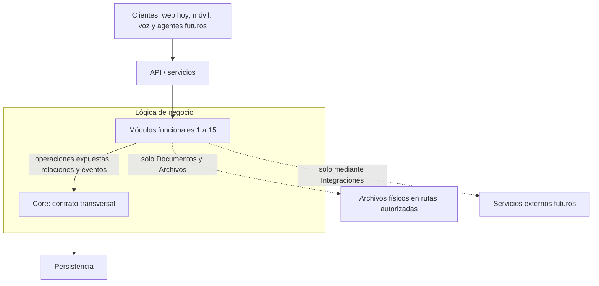

# Propuesta — Arquitectura global y límites de módulos

## Estado

**Propuesta pendiente de revisión.** No es arquitectura aprobada ni una línea base aplicable. Primera entrega del issue #59 (ARQ-2). Reúne en una vista global lo que ya está decidido, lo que solo está propuesto y lo que sigue pendiente, sin decidir de nuevo ninguna propuesta especializada.

**Versión y límites.** Se redacta sobre el estado del repositorio en el que CHG-033 es el último registro de cambio y [ADR-005](../13-adrs/ADR-005-modelo-core.md) la última ADR. Si esos documentos cambian, la revisión debe indicar contra qué versión se hizo. La propuesta puede aceptarse como propuesta con decisiones abiertas; no exige cerrar el piloto de agentes de desarrollo.

## Alcance y exclusiones

Cubre la separación de capas, los límites entre módulos, la responsabilidad y la propiedad de datos de cada uno de los 16 módulos, sus dependencias, y cinco flujos representativos.

No elige tecnologías, no define esquemas ni endpoints, no implementa código, no amplía el MVP y no reabre el modelo de Core de ADR-005. Los detalles de identidad (#58), fechas y avisos (#60), retención (#61) y alcance de IA e Integraciones (#57) pertenecen a sus propios issues y aquí solo se referencian.

## Convención de estado

- **Vigente:** decisión aprobada en una ADR.
- **Propuesta:** contenido de un estudio de módulo o de una propuesta, no aprobado.
- **Pendiente:** dependencia sin resolver que condiciona el elemento.

## Qué es vigente y qué no

| Tema | Estado | Fuente |
| --- | --- | --- |
| Separación clientes → API / servicios → Core y lógica de negocio → persistencia, con integraciones externas desacopladas | Vigente | [ADR-002](../general-docs/fuentes/adrs/ADR-002/ADR-002_ARQUITECTURA_MULTICLIENTE_MOVIL_VOZ.md) |
| Asana es herramienta de desarrollo y queda fuera del producto | Vigente | [ADR-001](../general-docs/fuentes/adrs/ADR-001/ADR-001_ASANA_DESARROLLO_VS_PRODUCTO.md) |
| Modelo conceptual de Core: entidad referenciable, relación explícita, evento interno idempotente sin orden garantizado, auditoría mínima | Vigente | [ADR-005](../13-adrs/ADR-005-modelo-core.md) |
| Contratos de los agentes de desarrollo (no son actores del producto) | Vigente | [ADR-003](../13-adrs/ADR-003-priorizacion-descubrimiento-ia-agentes.md), [ADR-004](../13-adrs/ADR-004-contratos-agentes-desarrollo.md) |
| Identidad, permisos y sesiones | Propuesta; acuerdo y ADR-006 pendientes | [Propuesta de identidad](propuesta-identidad-permisos.md), #58 |
| Fechas y avisos entre módulos | Propuesta en preparación | #60 |
| Retención y archivo | Propuesta en preparación | #61 |
| Alcance de IA / Agentes e Integraciones | Pendiente | #57 |
| Tecnologías, esquemas, endpoints y despliegue | Pendiente; fuera de esta propuesta | [Seguridad](../07-seguridad/README.md) |

## Vista global por capas

El diagrama es conceptual: no implica servicios, procesos ni tecnología.

## Reglas de frontera

| Regla | Estado | Fuente |
| --- | --- | --- |
| Los clientes acceden al sistema solo a través de la API / servicios. | Vigente | ADR-002 |
| Ningún módulo accede a los datos internos de otro; se relacionan mediante operaciones expuestas, relaciones y eventos de Core. | Vigente | ADR-005 |
| Core no contiene lógica de negocio de ningún módulo. | Vigente | ADR-005 |
| Todo evento es idempotente y no se garantiza orden entre eventos. | Vigente | ADR-005 |
| Solo Documentos y Archivos toca archivos físicos, dentro de rutas autorizadas, y nunca los mueve ni borra de forma implícita. | Propuesta | [Documentos y Archivos](../12-modulos/05-documentos-y-archivos.md) |
| Ningún módulo se conecta por su cuenta a servicios externos; lo hace Integraciones. | Propuesta | [Integraciones](../12-modulos/13-integraciones.md) |
| Una única política de autorización responde si un actor puede realizar una acción sobre un recurso. | Propuesta; Pendiente de acuerdo de identidad | [Identidad y Seguridad](../12-modulos/01-identidad-seguridad.md) |
| Un agente del producto opera solo mediante un contrato explícito, sin acceso irrestricto a los datos, y no hereda los privilegios del propietario. | Propuesta; Pendiente de #57 | [IA / Agentes](../12-modulos/14-ia-agentes.md), [propuesta de identidad](propuesta-identidad-permisos.md) |

## Matriz de los 16 módulos

Todos los módulos funcionales dependen de Core y de Identidad y Seguridad. La columna "Depende de" lista solo lo adicional. El estado de cada estudio de módulo es **Propuesta** salvo que se indique.

| Módulo | Responsabilidad | Datos de los que es dueño | Depende de (además) | Estado y pendientes | Fuente |
| --- | --- | --- | --- | --- | --- |
| 0. Core | Contrato transversal: entidades referenciables, relaciones, eventos y auditoría mínima. | Identificadores, relaciones, registro de eventos y auditoría; no el contenido de los módulos. | Persistencia | **Vigente** (ADR-005). Pendiente: autorización, tecnología de entrega de eventos. | [00](../12-modulos/00-core.md), ADR-005 |
| 1. Identidad y Seguridad | Quién es el actor, desde qué dispositivo y qué puede hacer. | Identidad, credencial, dispositivos y sesiones, permisos. | Core | Pendiente: acuerdo de identidad (#58) y ADR-006. | [01](../12-modulos/01-identidad-seguridad.md) |
| 2. Configuración | Preferencias y parámetros centralizados. | Ajustes, globales o de módulo. | Identidad | Valores de márgenes y rutas pendientes. | [02](../12-modulos/02-configuracion.md) |
| 3. Notificaciones | Entrega centralizada de avisos. | Notificaciones, canales, preferencias de aviso, historial. | Configuración | Pendiente: reparto de avisos (#60), retención del historial (#61). | [03](../12-modulos/03-notificaciones.md) |
| 4. Información Personal | Datos personales de base como referencia única. | Perfil personal. | Identidad | Campos concretos pendientes. | [04](../12-modulos/04-informacion-personal.md) |
| 5. Documentos y Archivos | Registro lógico y vínculo con el archivo físico. | Registros, metadatos, rutas gestionadas y referencias; el archivo físico queda fuera del módulo. | Configuración, Notificaciones, Backup | Pendiente: identidad estable de archivo, referencias rotas, qué se respalda. | [05](../12-modulos/05-documentos-y-archivos.md) |
| 6. Tareas | Trabajo pendiente del propietario. | Tareas, estados, prioridad, subtareas, fecha límite. | Configuración, Notificaciones | Pendiente: fechas y avisos (#60), retención (#61). | [06](../12-modulos/06-tareas.md) |
| 7. Calendario y Eventos | Vista temporal única. | Eventos propios; las fechas de otros módulos no son suyas. | Notificaciones; Tareas, Estudios, Finanzas como orígenes | Pendiente: mecanismo de reflejo (#60). | [07](../12-modulos/07-calendario-y-eventos.md) |
| 8. Estudios | Trayectoria formativa. | Programas, asignaturas, convocatorias, resultados. | Notificaciones, Documentos, Calendario | Pendiente: fechas y avisos (#60). | [08](../12-modulos/08-estudios.md) |
| 9. Finanzas | Situación económica personal registrada a mano. | Movimientos, categorías, planificación salarial, vencimientos. | Notificaciones, Documentos, Calendario | Muy sensible: acceso condicionado a identidad. Pendiente: #60. | [09](../12-modulos/09-finanzas.md) |
| 10. Guías y Procedimientos | Procedimientos reutilizables. | Guías, pasos, categorías, ejecuciones. | Documentos, Tareas | Alcance de ejecución pendiente. | [10](../12-modulos/10-guias-y-procedimientos.md) |
| 11. Búsqueda | Punto único de consulta. | Ningún dato autoritativo; solo resultados e índice derivados. | Todos los módulos funcionales | El historial de búsquedas no existe ni está aprobado. Pendiente: #61. | [11](../12-modulos/11-busqueda.md) |
| 12. Automatizaciones | Reglas que reaccionan a eventos. | Reglas, condiciones, ejecuciones. | Notificaciones; módulos de origen y destino | Catálogo de eventos y acciones pendiente. | [12](../12-modulos/12-automatizaciones.md) |
| 13. Integraciones | Conexiones con servicios externos. | Conexiones, alcance, registro de sincronización. | Notificaciones; Calendario, Documentos, Finanzas | Pendiente: alcance (#57). | [13](../12-modulos/13-integraciones.md) |
| 14. IA / Agentes | Contrato y contexto de los agentes del producto. | Contratos de agente, registro de interacciones. | Búsqueda, Automatizaciones, Notificaciones, Integraciones | Pendiente: alcance y contrato (#57). | [14](../12-modulos/14-ia-agentes.md) |
| 15. Backup y Recuperación | Copias, verificación y restauración. | Copias, política de respaldo, historial de copias. | Configuración, Notificaciones, Documentos; todos los módulos | Pendiente: retención (#61), alcance respecto de archivos físicos. | [15](../12-modulos/15-backup-y-recuperacion.md) |

## Flujos representativos

Todos cumplen las mismas propiedades. Los eventos son idempotentes y no se supone orden entre ellos. Cada operación relevante deja el registro mínimo de ADR-005. Ningún módulo lee ni escribe datos internos de otro.

**1. Crear una tarea con fecha límite que Calendario refleja y avisa.**
1. El cliente solicita la tarea a la API. *(Vigente)*
2. La política de autorización decide si el actor puede crearla. *(Propuesta; Pendiente de identidad)*
3. Tareas valida y guarda su dato, y Core registra la entidad referenciable. *(Vigente)*
4. Tareas emite el evento de creación y se registra la auditoría mínima. *(Vigente)*
5. Core relaciona la fecha con Calendario, que la refleja sin copiarla ni editarla. *(Propuesta; Pendiente de #60)*
6. Tareas decide cuándo toca avisar y Notificaciones entrega el aviso. *(Propuesta; Pendiente de #60)*

**2. Registrar un documento y relacionarlo con una tarea.**
1. El cliente envía la petición a la API y se comprueba la autorización. *(Vigente / Propuesta)*
2. Documentos verifica que el archivo está en una ruta autorizada y no lo modifica. *(Propuesta)*
3. Documentos crea el registro lógico, Core guarda la relación con la tarea y se emite el evento con su auditoría. *(Vigente)*
4. Tareas consulta "qué está relacionado" mediante Core, sin acceder a los datos de Documentos. *(Vigente)*

**3. Buscar un elemento.**
1. El cliente envía la consulta a la API y Búsqueda la recibe. *(Vigente)*
2. Búsqueda consulta solo los campos que cada módulo expone como buscables. *(Propuesta)*
3. Se excluyen los resultados que el actor no puede ver. *(Propuesta; Pendiente de identidad)*
4. Se devuelven referencias al elemento original, que Búsqueda no edita. La consulta no se almacena porque el historial no está aprobado. *(Propuesta; Pendiente de #61)*

**4. Restaurar una copia de seguridad.**
1. El cliente solicita la restauración a la API; es una acción sensible que puede exigir reautenticación. *(Propuesta; Pendiente de identidad)*
2. Backup verifica la copia y pide confirmación explícita. *(Propuesta)*
3. Se restauran los datos de los módulos incluidos; el alcance por módulo está sin decidir. *(Propuesta; Pendiente)*
4. Core registra el evento y la auditoría, y Notificaciones avisa del resultado. *(Vigente / Propuesta)*
5. Pueden reaparecer elementos eliminados después de la copia; sus casos pertenecen a #61. *(Pendiente)*

**5. Un agente del producto consulta o propone una acción (futuro).**
1. El agente usa un contrato explícito y entra por la misma API que cualquier cliente. *(Propuesta; Pendiente de #57)*
2. Solo invoca operaciones ya expuestas y recibe el contexto que el contrato permite. *(Propuesta)*
3. Una acción que modifica datos queda como propuesta hasta la confirmación del propietario. *(Propuesta)*
4. Cada interacción relevante deja registro. *(Vigente: mecanismo de auditoría; Propuesta: contenido)*

## Dependencias que condicionan la aprobación

| Dependencia | Qué condiciona | Estado |
| --- | --- | --- |
| Acuerdo de identidad, permisos y sesiones (#58) | La autorización de todos los flujos y la aprobación de una línea base aplicable. | Pendiente |
| Fechas y avisos (#60) | Flujo 1 y módulos 3, 6, 7, 8 y 9. | Propuesta en preparación |
| Retención y archivo (#61) | Módulos 3, 6, 11 y 15 y el flujo 4. | Propuesta en preparación |
| Alcance de IA / Agentes e Integraciones (#57) | Módulos 13 y 14 y el flujo 5. | Pendiente |
| Elección de tecnologías | Todo lo que no es conceptual. | Pendiente; fuera de alcance |

## Qué no resuelve esta propuesta

No decide la tecnología de persistencia, de mensajería ni de despliegue, ni define esquemas, endpoints o el orden de implementación. No amplía el MVP de ningún módulo ni convierte en arquitectura aprobada ninguna propuesta especializada.

## Adopción

Si se acuerda, la integración coordinada, a cargo de un único integrador, añadiría un enlace desde el [README de arquitectura](README.md). Una línea base aplicable requiere además el acuerdo de identidad y las decisiones que afecten a su alcance. Hasta entonces, ningún documento distinto de esta propuesta se modifica.