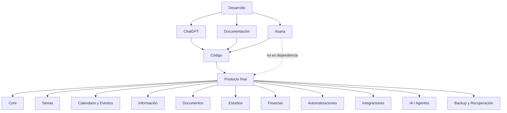

# ADR-001 — Separación de Asana entre desarrollo y producto

## Estado
DECISIÓN

## Fecha
2026-09-17

## Contexto
Asana se utilizará para gestionar el trabajo de desarrollo del proyecto: tareas, prioridades, dependencias, cambios, pruebas y seguimiento.

Se evaluó integrarlo también en el producto final para gestionar o sincronizar las tareas de la aplicación.

## Problema
Incluir Asana en el producto final introduciría una dependencia externa en una parte central del sistema y condicionaría el diseño de Tareas, Calendario, automatizaciones y futuros agentes.

## Objetivo
Separar completamente el producto final del sistema utilizado para gestionar su desarrollo.

## Decisión
Asana NO formará parte del producto final.

El producto tendrá sistemas propios para:
- Tareas.
- Calendario y Eventos.
- Relaciones entre entidades.
- Automatizaciones.
- Futuras integraciones externas.

Asana se utilizará exclusivamente como herramienta de gestión del desarrollo.

## Responsabilidades
### ChatGPT
Análisis, investigación, diseño, planificación y apoyo a la implementación.

### Documentación
Fuente de verdad técnica del proyecto.

### Asana
Tareas, estado, prioridades, dependencias y seguimiento del desarrollo.

### Código
Implementación real del sistema.

## Arquitectura conceptual

## Consecuencias positivas
- El producto no depende de Asana.
- Máxima libertad para diseñar Tareas y Eventos.
- Las entidades pueden relacionarse directamente entre módulos.
- Se facilita el funcionamiento privado/local.
- Las integraciones externas pueden sustituirse sin modificar el núcleo.
- Los futuros agentes de IA permanecen desacoplados.

## Costes
- Hay que desarrollar nuestro propio gestor de tareas.
- Hay que desarrollar nuestro propio calendario/eventos.
- Las funcionalidades avanzadas se implementarán cuando sean necesarias.
- Asana no será almacenamiento ni respaldo del producto.

## Alternativas consideradas
### A. Asana como sistema principal
RECHAZADA: dependencia externa en una función central.

### B. Sistema propio sincronizado con Asana
RECHAZADA para el producto final: añade complejidad y dependencia conceptual.

### C. Sistema propio sin Asana
SELECCIONADA: máxima independencia y libertad arquitectónica.

## Alcance de Asana
Asana pertenece al entorno de desarrollo, no a la aplicación. Ningún requisito funcional del producto dependerá de Asana.

## Trazabilidad
REQUISITO → DISEÑO → IMPLEMENTACIÓN → PRUEBA → DOCUMENTACIÓN → ASANA

Asana gestiona el trabajo asociado a la trazabilidad, pero no implementa ninguna funcionalidad del producto.

## Impacto en módulos
- Módulo 7 — Tareas: completamente propio.
- Módulo 8 — Calendario y Eventos: completamente propio.
- Automatizaciones: propias.
- Integraciones: desacopladas y futuras.
- IA / Agentes: desacoplada.
- Core: sin dependencia de Asana.

## Pendientes
- Modelo de datos de Tareas.
- Modelo de datos de Eventos.
- Relaciones entre Tareas, Eventos y otras entidades.
- Recurrencias, estados, prioridades y reglas de negocio.
- Automatizaciones relacionadas.
- Requisitos funcionales y no funcionales.

## Regla de mantenimiento
Si en el futuro se plantea Asana como dependencia del producto, deberá revisarse mediante una nueva ADR que sustituya explícitamente esta decisión.
