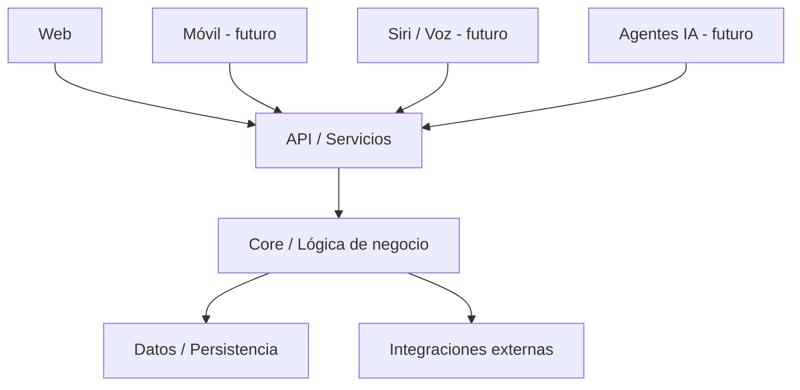

# ADR-002 — Arquitectura preparada para múltiples clientes, móvil y voz

## Estado
DECISIÓN

## Fecha
2026-09-17

## Contexto
La primera versión del producto será una aplicación web responsive. En el futuro se quiere disponer también de una aplicación móvil y permitir interacción mediante asistentes de voz, inicialmente con Siri, para acciones como crear tareas, eventos o recordatorios.

Estas capacidades no forman parte del MVP, pero la arquitectura debe evitar decisiones que hagan difícil incorporarlas posteriormente.

## Problema
Si la lógica de negocio queda acoplada a la interfaz web, añadir una aplicación móvil o una interfaz de voz obligaría a duplicar lógica y aumentaría el acoplamiento y la superficie de mantenimiento.

## Objetivo
Separar la interfaz de usuario de la lógica de negocio y de los datos, de forma que diferentes clientes puedan utilizar una API y servicios comunes.

## Decisión
El sistema se diseñará con una separación clara entre:
- Clientes/interfaces: web inicialmente; móvil y voz como evolución futura.
- API y servicios de aplicación.
- Core y lógica de negocio.
- Persistencia y datos.
- Integraciones externas.

La aplicación móvil y la integración con Siri no se implementarán en el MVP.

Siri se tratará como una futura integración/canal de interacción y no como dependencia del núcleo.

## Arquitectura conceptual

## Principios derivados
1. Las operaciones de negocio importantes no dependerán de una pantalla concreta.
2. Crear o modificar una tarea será una operación del sistema reutilizable por distintos clientes.
3. La API será una frontera controlada de acceso al sistema.
4. La autenticación y autorización se aplicarán también a clientes futuros.
5. Las acciones sensibles deberán poder validarse y auditarse.
6. Los clientes futuros podrán sustituirse o desactivarse sin reconstruir el núcleo.

## Seguridad futura
La interacción por voz no implicará acceso general a los datos. Deberán definirse posteriormente:
- autenticación del cliente;
- autorización por operación;
- permisos mínimos;
- validación de acciones sensibles;
- auditoría;
- revocación de acceso;
- protección frente a órdenes ambiguas o no autorizadas.

## Impacto en módulos
- Core: debe permanecer independiente de la interfaz.
- Tareas: operaciones reutilizables mediante API/servicios.
- Calendario y Eventos: mismo principio.
- Identidad y Seguridad: debe contemplar futuros clientes.
- Integraciones: deberá permitir canales externos desacoplados.
- IA/Agentes: deberá utilizar las mismas fronteras de seguridad.
- Frontend: inicialmente web responsive.

## Alcance del MVP
Incluido como requisito arquitectónico de preparación.
No incluido como funcionalidad:
- aplicación móvil;
- integración con Siri;
- comandos de voz;
- funcionalidades específicas de iOS.

## Pendientes
- Definir arquitectura concreta de API.
- Elegir tecnología web y backend.
- Definir autenticación y gestión de sesiones.
- Diseñar permisos y auditoría.
- Estudiar estrategia futura para iOS/Siri cuando corresponda.
- Definir contratos de API estables para operaciones de tareas y eventos.

## Consecuencia
Se añade algo de disciplina arquitectónica desde el inicio, pero se reduce el riesgo de tener que rehacer el núcleo cuando aparezcan nuevos clientes o canales de interacción.

## Regla de mantenimiento
La incorporación futura de móvil o voz deberá respetar la separación entre interfaz, API, lógica de negocio y datos. Si una nueva decisión contradice esta ADR, deberá registrarse una nueva ADR.
